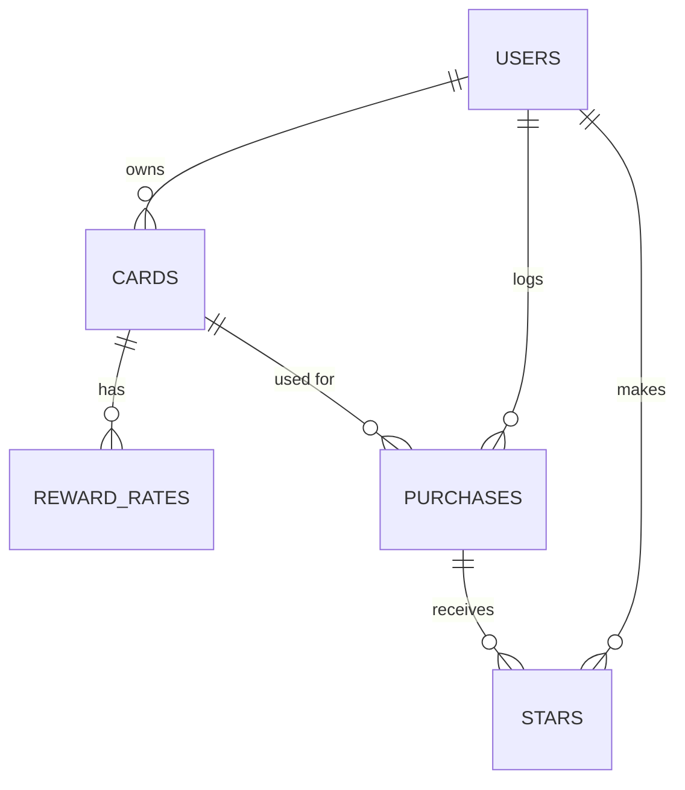

# Card Tracker: Plan

## 1. Pitch

I'm building **Card Tracker** because I carry several credit cards and never know which one earns the most for a given purchase, and I have no idea how much I'm actually earning (or leaving on the table) each month. I'll use it a few times a week, logging purchases right after I make them and checking the dashboard at the end of each month.

I built a simple single-page prototype of a "best card" picker earlier. This app is a new build: real accounts, a database, purchase logging, and a dashboard.

## 2. Features

Numbered in the order I'll build them. Each one is its own Issue, branch, and pull request.

1. **Sign up and login.** As a new visitor, I want to create an account with my email and a password, then log in and log out, so that my cards and purchases are private to me.
2. **My cards (data model).** As a user, I want to add each card I own with its name, reward type (cash back or points), what a point is worth to me in cents, and its reward rate for each spending category, so that the app knows what each card earns.
3. **Log purchases (create / read / update / delete).** As a user, I want to add a purchase with merchant, amount, date, category, and the card I used, see all my purchases in a list, open one purchase's detail page, edit it, and delete it after an "are you sure?" confirmation, so that I have an accurate record of my spending.
4. **Validation.** As a user, I want a friendly message if I leave merchant, amount, date, category, or card blank, or enter an amount of zero or less, so that I don't save broken entries.
5. **Stars.** As a user, I want to star a purchase and see a "Starred" view, so that I can flag purchases to come back to, like a charge to dispute or a return to make.
6. **Find things.** As a user, I want to search purchases by merchant, filter by card or category, and sort by newest, oldest, or largest amount, so that I can find a specific purchase quickly.
7. **Dashboard.** As a user, I want to see a bar chart of rewards earned by card, plus my total spend this month, total rewards earned, and effective reward rate, so that I know what my cards are actually earning me.
8. **Best card for a category** *(my feature)*. As a user, I want to pick a category and see which of my cards earns the most for it, with ties shown and points converted to dollars using my point value, so that I use the right card at checkout.
9. **Missed rewards** *(my feature)*. As a user, I want each purchase to show how much more I'd have earned with my best card for that category, and a "missed this month" total on the dashboard, so that I can see what using the wrong card costs me.
10. **Card presets** *(my feature)*. As a user, I want to pick my card from a list of common credit cards with its reward type, point value, and category rates already filled in (and still be able to edit them), so that I can set up my cards in seconds instead of typing every rate.

## 3. Database

No card numbers, expiry dates, CVVs, or account numbers are stored anywhere. Cards are identified only by a name I choose.

**users** (our own table)

Supabase Auth keeps login details (like passwords) in its own private `auth.users` table. Our app has its own public `users` table, and a database trigger adds a row to it automatically every time someone signs up, so every account is a row in our users table.

| Column | Type | Notes |
|---|---|---|
| id | text | Primary key; the same id as the Supabase Auth account |
| email | text | Required, unique |
| created_at | date | Set automatically |

**cards**
| Column | Type | Notes |
|---|---|---|
| id | number | Primary key |
| user_id | text | Links to users.id |
| name | text | Required, e.g. "Sapphire Preferred" |
| reward_type | text | "cashback" or "points" |
| point_value_cents | number | Cents per point; 1 for cash back cards |
| annual_fee | number | Dollars |
| is_active | true/false | Hide cards I've closed |
| created_at | date | Set automatically |

**reward_rates**
| Column | Type | Notes |
|---|---|---|
| id | number | Primary key |
| card_id | number | Links to cards.id |
| category | text | One of the fixed categories below |
| rate | number | % for cash back, multiplier for points |

**purchases** (main item)
| Column | Type | Notes |
|---|---|---|
| id | number | Primary key |
| user_id | text | Links to users.id |
| card_id | number | Links to cards.id |
| merchant | text | Required |
| amount | number | Dollars, required, greater than 0 |
| category | text | Required, one of the fixed categories |
| purchase_date | date | Required |
| notes | text | Optional |
| created_at | date | Set automatically |

**stars** (junction table)
| Column | Type | Notes |
|---|---|---|
| id | number | Primary key |
| user_id | text | Links to users.id |
| purchase_id | number | Links to purchases.id |
| created_at | date | Set automatically |

A user can star a purchase only once (user_id + purchase_id is unique).

**Who can see and change what (row-level security):** each user can see, add, edit, and delete only their own rows in users, cards, reward_rates, purchases, and stars. A purchase may only reference one of the logged-in user's own cards; the database rejects a purchase that points at anyone else's card. Likewise, a star may only point at one of the logged-in user's own purchases.

**Card presets** are a built-in list in the app's code, not a database table. Picking a preset copies its values into a new row in cards and its rates into reward_rates, so editing my card later never changes the preset.

**Fixed categories:** Dining, Groceries, Gas, Travel, Online Shopping, Streaming, Drug Stores, Transit, Everything Else.

**Rewards math:** rewards for a purchase = amount × rate ÷ 100 for cash back cards, and amount × rate × point_value_cents ÷ 100 for points cards. If a card has no rate for a category, its "Everything Else" rate is used. Rewards are calculated when needed, not stored, so editing a card's rates updates every purchase.

**How tables connect**
- users → cards: one-to-many (a user has many cards)
- cards → reward_rates: one-to-many (a card has a rate for each category)
- users → purchases: one-to-many
- cards → purchases: one-to-many (each purchase was made with one card)
- users ↔ purchases through stars: many-to-many

## 4. Tests

**Test 1: Data isolation**
Given User A has one card and two purchases, when User B logs in and opens the purchases list, the cards list, and User A's purchase detail page by its direct link, then User B's lists are empty and the detail page shows "not found."

**Test 2: Dashboard stat (total rewards earned)**
Given a user has one cash back card earning 3% on Dining and 1% on Everything Else, and logs a $100 Dining purchase and a $50 Groceries purchase this month, when they open the dashboard, then total spend shows $150.00, total rewards earned shows $3.50, and effective reward rate shows 2.33%.

## 5. Technologies

- **Coding agent: Claude Code.** It's my agent for this app because it works directly in my GitHub repo: it creates the Issues, branches, and pull requests, and I review and merge. (I used Replit Agent for my earlier portfolio site.)
- **App framework: Next.js.** It handles pages and server logic in one project and deploys easily to Vercel.
- **Database: Supabase (Postgres).** It's a free hosted database with row-level security, which enforces "each user sees only their own data" at the database level.
- **Sign up and login: Supabase Auth with email and password.** It's built into the same service, and a trigger copies each new account into our own users table.
- **Hosting: Vercel.** Every merge to main deploys automatically, so the live URL stays current.
- **Chart library: Recharts.** It's a simple, widely used chart library for React.
- **Tests: Vitest.** It's fast and runs with one command, which makes the red/green screenshots easy.

## 6. Design

- **Feel: like a native Apple app.** Quiet, precise, and uncluttered: content first, very little decoration, generous white space.
- **Light and dark mode.** The app follows my device's setting by default, with a System / Light / Dark switch. Both modes are designed on purpose, not just inverted: light mode is an off-white background (#F2F2F7) with white panels; dark mode is true black (#000000) with raised dark-gray panels (#1C1C1E).
- **One accent color: teal**, carried over from my prototype. It's #00A19C in dark mode and a slightly deeper #007C77 in light mode so text and buttons stay readable on white. Everything else is grayscale; category colors only appear as small dots.
- **Type:** Apple's system font (San Francisco, with each device's own system font as a fallback), large bold page titles, and evenly spaced digits so dollar amounts line up in columns.
- **Layout:** rounded, grouped lists like iOS Settings with thin dividers; each purchase is a row with merchant, card, amount, and a star. A frosted, see-through header blurs content scrolling under it. On phones there's a bottom tab bar (Purchases, Starred, Dashboard, Cards); on wider screens it becomes a sidebar.
- **Dashboard:** large stat tiles (spend this month, rewards earned, effective rate, missed this month) above a clean bar chart with rounded bars and almost no gridlines, like the Health app.
- **Interactions:** add and edit open in a panel that slides up from the bottom, delete asks "are you sure?" in a native-style dialog, and the star fills with the accent color. Motion is subtle and turns off if the device's "reduce motion" setting is on.
- **Mobile-first**, since I'll usually log purchases on my phone right after paying.
- **Inspiration:** Apple Card and Apple Wallet (purchase list), the Health app (summary tiles and charts), iOS Settings (grouped lists), and Copilot Money (spending dashboard).

## 7. Risks and cuts

- **Least sure I can build: card presets.** Keeping preset rates accurate is hard because card issuers change their rewards, and a wrong preset means wrong rewards everywhere that card is used.
- **What I'll cut first:** card presets. If I'm short on time, users enter each card's rates by hand, which feature 2 already supports.
- **Other risk:** keeping the rewards math right for points cards. The dashboard test (Test 2) is there to catch mistakes.
- **Simplification:** cards with capped or rotating categories (e.g. Citi Custom Cash, Discover it) are approximated with a fixed rate per category, so their rewards may be off in some months.

<!--
At the end, add a "Plan vs. Reality" section here with this table. Don't edit the plan above to match what shipped.
| Planned feature | Shipped / Changed / Cut | Status (Done/Backlogged) | Learning | What changed and why (one line) |
-->
