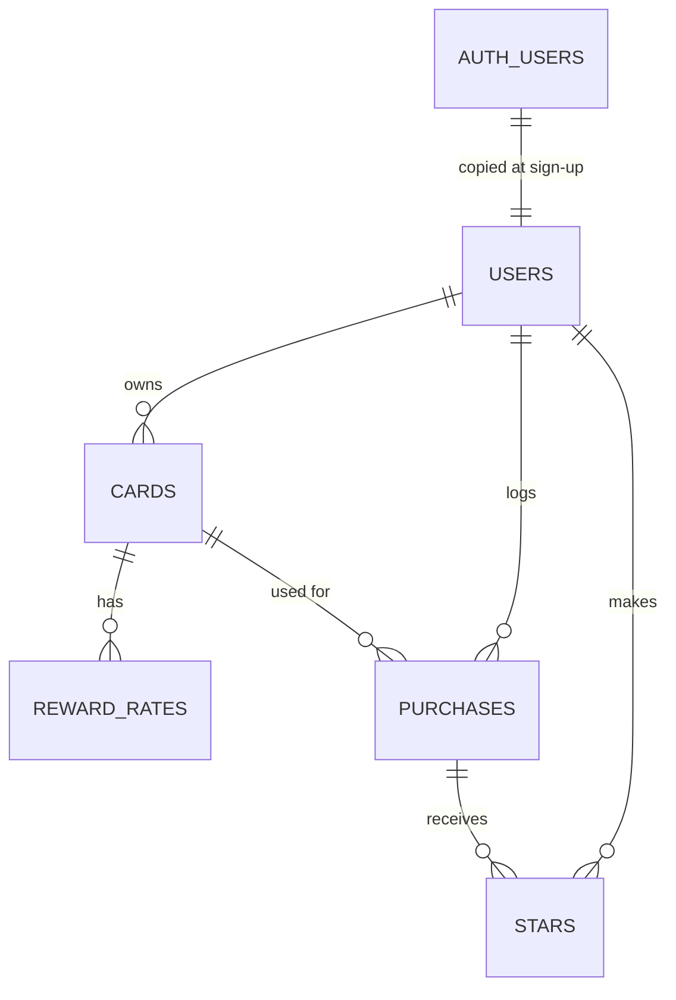

# Card Tracker: database schema

The app stores its data in **Supabase (Postgres)**. There are five tables of our own (`users`, `cards`, `reward_rates`, `purchases`, `stars`), plus Supabase's private `auth.users` table, which holds login details like passwords. The SQL that creates everything is in [`supabase/migrations/`](supabase/migrations/), one file per feature, run in date order.

No card numbers, expiry dates, CVVs, or account numbers are stored anywhere. A card is just a name the user chooses.

## How the tables connect

In plain English:

- **users → cards: one-to-many.** A user has many cards; each card belongs to one user.
- **cards → reward_rates: one-to-many.** A card has a rate for each category it earns extra on. Categories without a rate use the card's "Everything Else" rate.
- **users → purchases: one-to-many.** A user logs many purchases.
- **cards → purchases: one-to-many.** Each purchase was made with one card; a card can have many purchases.
- **users ↔ purchases through stars: many-to-many.** `stars` is the junction table: one row means "this user starred this purchase."

## Tables

### users (our own)

Supabase keeps accounts in its private `auth.users` table. A **database trigger** (`on_auth_user_created`) copies every new sign-up into this table, so every account is a row in *our* users table.

| Column | Type | Notes |
|---|---|---|
| id | uuid | Primary key. The same id as the Supabase Auth account; deleting the account deletes this row. |
| email | text | Required, unique |
| created_at | timestamptz | Set automatically. Shown as "Member since" on the Account page. |

### cards

| Column | Type | Notes |
|---|---|---|
| id | bigint | Primary key, numbered automatically |
| user_id | uuid | → users.id. Filled in automatically with the logged-in user. |
| name | text | Required (not blank), e.g. "Sapphire Preferred" |
| reward_type | text | `cashback` or `points` |
| point_value_cents | numeric(6,2) | What one point is worth, in cents. Always 1 for cash back cards. Must be more than 0. |
| annual_fee | numeric(8,2) | Dollars, 0 or more (default 0) |
| is_active | boolean | False once the card is closed. Closed cards stay on past purchases but aren't offered for new ones or suggested as "best." |
| created_at | timestamptz | Set automatically |

### reward_rates

| Column | Type | Notes |
|---|---|---|
| id | bigint | Primary key |
| card_id | bigint | → cards.id. Deleting a card deletes its rates. |
| category | text | One of the 9 fixed categories (below) |
| rate | numeric(5,2) | % for cash back, points per dollar for points cards. 0 or more. |

A card can have only one rate per category (`card_id + category` is unique).

### purchases (the main item)

| Column | Type | Notes |
|---|---|---|
| id | bigint | Primary key |
| user_id | uuid | → users.id. Filled in automatically. |
| card_id | bigint | → cards.id. A card with purchases can't be deleted (close it instead). |
| merchant | text | Required (not blank) |
| amount | numeric(10,2) | Dollars, required, more than 0 |
| category | text | Required, one of the 9 fixed categories |
| purchase_date | date | Required |
| notes | text | Optional |
| created_at | timestamptz | Set automatically |

### stars (junction table)

| Column | Type | Notes |
|---|---|---|
| id | bigint | Primary key |
| user_id | uuid | → users.id. Filled in automatically. |
| purchase_id | bigint | → purchases.id. Deleting a purchase removes its star. |
| created_at | timestamptz | Set automatically |

A user can star a purchase only once (`user_id + purchase_id` is unique). Unstarring deletes the row.

**Fixed categories:** Dining, Groceries, Gas, Travel, Online Shopping, Streaming, Drug Stores, Transit, Everything Else. The database refuses anything else.

## Who can see and change what (row-level security)

Every table has row-level security turned on, so **the database itself** only returns and changes the logged-in user's own rows. The app never has to remember to filter by user.

| Table | Rule |
|---|---|
| users | Read your own row only |
| cards | Read, add, edit, and delete your own cards only |
| reward_rates | Read and change rates only on your own cards (it has no user_id; ownership comes from the card) |
| purchases | Read, edit, and delete your own; **add or edit only with one of your own cards** |
| stars | Read and remove your own; **star only your own purchases** |

So another user's purchase, even opened by its direct link, simply doesn't exist for you: the page says "Not found."

## What's *not* in the database

- **Rewards earned, missed rewards, and the best card** are calculated when needed from purchases, cards, and rates (`lib/rewards.ts`, `lib/missed.ts`, `lib/best-card.ts`). They're never stored, so editing a card's rates updates every purchase.
- **Card presets** are a list in the code (`lib/card-presets.ts`). Picking one copies its values into a new row in `cards` and `reward_rates`, so editing your card never changes the preset.

## Compared to the plan (PLAN.md section 3)

Did Claude Code build what I designed? **Yes: the same five tables, relationships, and rules.** These are the differences, mostly the plan's plain-English types becoming real database types, plus extra safety rules:

| Planned | Built | Why |
|---|---|---|
| ids are "text" / "number" | users.id is a **uuid**; other ids are **bigint**, numbered automatically | users.id must match Supabase Auth's id, which is a uuid |
| created_at is a "date" | **timestamptz** (date and time) | Records the exact moment, in any time zone |
| amount, rate, point value, fee are "number" | **numeric** with fixed decimals | Exact money math, no rounding errors like 0.1 + 0.2 |
| (not in plan) | One rate per category per card (unique) | Stops a card from having two Dining rates |
| (not in plan) | Database checks: categories must be one of the 9, amount > 0, name not blank, etc. | A backstop behind the friendly form messages (feature 4) |
| (not in plan) | A card with purchases can't be deleted | Purchases would otherwise lose their card. Added with the Delete Card button (my decision in feature 2) |
| Deleting a user deletes their data | Same: users → cards, purchases, stars, and cards → reward_rates all cascade | As planned |
